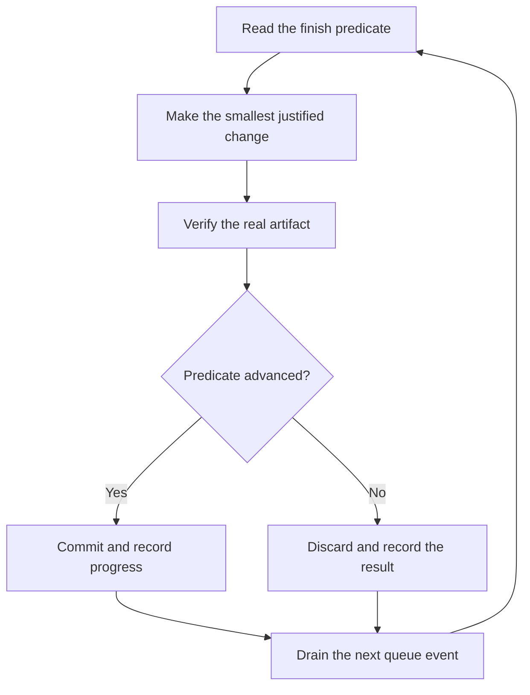

# Run work while you sleep

An overnight run is safe only when the next agent can answer four questions without the
human. What is the goal? What proves it is done? What may it change? When must it stop?

## The overnight handoff

```text
/vistack I am going to bed. Migrate every caller to the new parser in a fresh worktree.
Done means zero old callers, all parser fixtures pass, and the old API is deleted.
Keep parser output unchanged. Commit and push slice branches, but do not merge.
Keep the decision ledger. If the blocker loop is exhausted, stop and write the dossier.
```

The goal gives the run its scope. The finish predicate lets every iteration decide whether
it advanced. The permission line lets reversible work continue without a confirmation. The
withheld action protects the merge boundary. The escape hatch prevents creative goal changes
after a dead end.

## What the loop does



Each iteration has one change, one check, and one ledger row. A change that does not help is
discarded. A plateau changes the approach, not the finish predicate. A stalled lane is
reconciled and routed to `blocker`, not left waiting for a completion notification.

## State and wake mechanisms

The run writes state and its ledger before dispatch. Claude Code uses `.claude/state/` and
the self-paced `/loop /vistack babysit <slug>`. Completion events wake agent lanes, and
external state such as PR checks is polled at its own change rate; the Monitor section of
`skills/coordinate/SKILL.md` has the rules. Codex uses `.codex/vistack/state/` and the host's
recurring-task or background equivalent when available. A persisted `active` monitor flag is
not proof of a live process. The coordinator records its owner and verifies the wake
mechanism after every pickup.

One monitor owns the run. A second monitor is not a recovery strategy. Reconcile state,
branches, worktrees, PRs, and agent status first.

## The morning audit

Run `show-me-your-work` or read the state and ledger directly. Check every row against a real
action, every evidence pointer against a file, URL, SHA, command output, or artifact, and
every important pivot or discarded attempt against the trail. Read the Attention section
first, then inspect the rows it names. Open the run report at
`<state-root>/reports/<slug>.html` before anything else; it is the fast read, and the ledger
stays the source of truth.

The result is merge-ready draft PRs, not merged code. Merging, deployment, data deletion,
secret changes, and other irreversible actions remain human-owned fences.

## Nightly routines

Two playbooks run unattended on a schedule against one repository, on the operator's request:

- `crash-hunt` (01:30 every night) boots the real app on loopback against a disposable
  database, sends it random and malformed requests, fixes the root cause of one new crash, and
  opens one draft PR (`skills/crash-hunt/SKILL.md`).
- `maintenance` (06:00, Monday to Friday) picks the one change most likely to prevent a
  production incident and opens one draft PR, or reports that no candidate cleared the bar
  (`skills/maintenance/SKILL.md`).

In the morning there are at most one draft PR per routine, the run report at
`<state-root>/reports/<slug>.html`, and the run's log at
`~/.vistack/routines/<repo-key>/<routine>-<date>.log`. Nothing is merged.

Ask for a routine by repository name. The install, the prerequisites it checks, and the
removal commands are in `skills/routine-healthcheck/SKILL.md` (Install, Nightly repository
routines); the runner is `scripts/run-routine.sh`. The runner takes one lock per repository,
so a run that starts while another holds it logs `skipped: <routine> already running` and
exits, and a run that passes `VISTACK_ROUTINE_MAX_MINUTES` is killed. With the default 240
minutes, a `crash-hunt` started at 01:30 ends by 05:30, before `maintenance` starts at 06:00;
raising the limit or moving a time can bring them back into overlap, and the later run is then
skipped. A killed run's leftover
app and database are cleaned by the next `crash-hunt` pre-boot gate.
